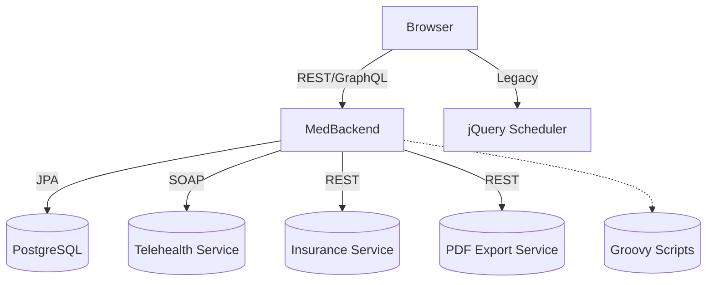

# Architecture Overview

## System Architecture

## Components

### Backend
- **Architecture**: Spring Boot monolith with modular packages
- **Modules**:
  - `appointment` - Appointment scheduling and management
  - `billing` - Invoice and payment processing
  - `patient` - Patient and provider management
  - `integration` - External service integrations
  - `legacy` - Legacy Groovy scripts for billing adjustments
- **APIs**:
  - REST endpoints for CRUD operations
  - GraphQL for complex queries
  - SOAP client for telehealth integration
- **Security**: JWT-based authentication and authorization

### Frontend
- **Architecture**: React + TypeScript single-page application
- **UI Libraries**:
  - Ant Design for modern components
  - jQuery FullCalendar for legacy scheduler
- **State Management**:
  - React Query for data fetching
  - Redux Toolkit for billing state
  - Context API for authentication

### Database
- **Type**: PostgreSQL 14
- **Migrations**: Flyway for schema versioning
- **Seed Data**: Fixture data in `ops/seed/`

### External Services
- **Telehealth**: SOAP-based integration for video sessions
- **Insurance**: REST API for eligibility verification
- **PDF Export**: Microservice for document generation

## Data Flow

1. User interacts with React frontend
2. Frontend calls backend REST/GraphQL APIs
3. Backend processes requests using service layer
4. Data persisted to PostgreSQL via JPA
5. External services called when needed (insurance, telehealth, PDF)
6. Responses returned to frontend for display

## Security

- JWT tokens for authentication
- Spring Security for authorization
- HTTPS for production deployments
- Sensitive data encrypted at rest

## Deployment

- Mock services for development and testing
- Run scripts for local development (`run-backend.sh`, `run-frontend.sh`)
